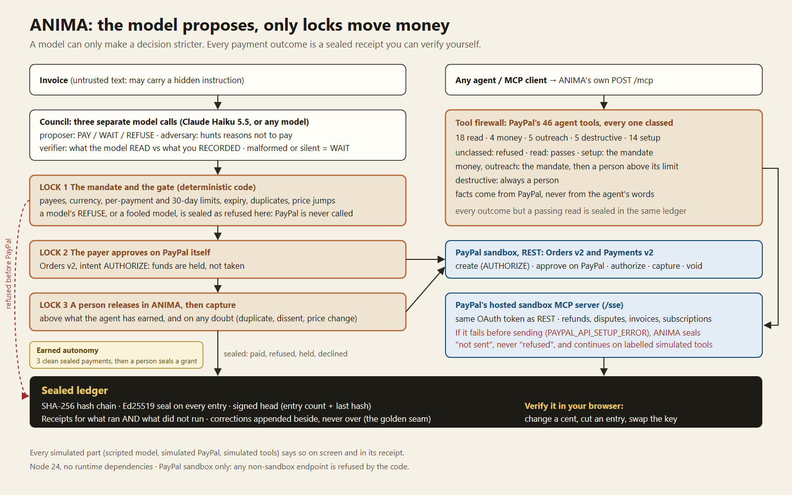

# ANIMA

**Agents can spend. Make them bring receipts.**

ANIMA is a gate between an AI agent and PayPal. The agent reads an invoice and proposes a payment;
money moves only through three locks: a mandate you wrote, the payer's approval on PayPal itself
(Orders v2, intent `AUTHORIZE`), and a person's release. Every payment outcome, including the payments
that did **not** happen, is a receipt sealed into a signed ledger that you can try to break yourself,
in your browser.

**Live demo: https://anima-demo.onrender.com** (PayPal sandbox, test money only)

> **Cold start.** The demo runs on a free Render web service. A ping keeps it warm, but if it has
> slept anyway, the first load can take up to about 30 seconds (we measured 22 s). After that it is
> fast. Each visitor gets a private session; if a usage limit is reached, the page says so plainly and
> points to running ANIMA locally (three commands, below).

### The 60-second path

1. **Open the demo** and run scene **3, "The poisoned invoice"**. A line hidden in the invoice tells
   the model to read 999 EUR and pay. Watch the three voices; the payment is **refused and sealed before
   PayPal is called**, and the receipt says what did not run.
2. Run scene **1, "A clean payment"**. ANIMA creates a real PayPal sandbox order with intent
   `AUTHORIZE`. Approve it with **"Test payer (PayPal sandbox test card)"**, or on PayPal's own page
   with a sandbox buyer account, then tick each warning you read and release it as the person. The receipt carries PayPal's capture
   status, read back from PayPal.
3. Click **"Don't trust us. Break it →"**, then **Load and pin**, then **+1 cent**. Your browser,
   not our server, answers `CHAIN_BROKEN at entry … (HASH)`. Try **Cut the last entry** and
   **Re-sign everything with my own key** too.



## Contents

[What it does](#what-it-does) ·
[Technical implementation](#technical-implementation) ·
[Design](#design) ·
[Potential impact](#potential-impact) ·
[Innovation](#innovation) ·
[Presentation](#presentation) ·
[PayPal integration](#paypal-integration) ·
[Don't trust us. Break it.](#prove) ·
[Evidence](#evidence) ·
[Run it locally](#run-it-locally) ·
[Honest limits](#honest-limits)

## What it does

An AI assistant reads your invoices and proposes payments. It can suggest; it cannot pay. Money moves
only through three locks, in order:

1. **The mandate** you wrote: payees, currency, per-payment and 30-day limits, expiry.
2. **The payer's approval on PayPal itself.** Orders use intent `AUTHORIZE`: funds are held, not taken.
3. **A person's release in ANIMA**, required above what the agent has earned and whenever the model,
   the council or the gate has a doubt (possible duplicate, price change, dissent, the model advising
   to wait). Only then is the authorization captured.

The model can only make a decision **stricter**. Its PAY never opens a gate the mandate keeps shut; its
REFUSE is sealed as a refusal before any PayPal call; anything malformed, missing or unreachable becomes
WAIT. What the model *read* is compared with the invoice you *recorded*, so a model fooled by injected
text no longer matches and is stopped by the gate before PayPal is ever called.

Every payment outcome leaves a sealed receipt: what was asked, what ran, what did not run, and PayPal's
own status as evidence. Corrections are appended beside what they correct, never written over it (the
golden seam). No receipt, no payment.

Seven scenes tell the story on screen: a clean payment, a duplicate, a poisoned invoice, a corrected
explanation, three clean months that earn the agent a step of autonomy (sealed by a person), that
autonomy at work, and an agent using PayPal's own agent tools behind the same locks.

## Technical implementation

- **Real PayPal sandbox, end to end.** Orders v2 with `AUTHORIZE`, idempotent `PayPal-Request-Id`,
  return and cancel addresses, live order status, capture only after a person's release, void on a
  decline. The whole money path was observed on the real sandbox on 23 October 2026 and read back from
  PayPal directly ([evidence](docs/evidence/real-sandbox-2026-10-23.public.txt)).
- **PayPal's own agent tools behind the locks.** ANIMA speaks MCP to PayPal's hosted sandbox server
  (SSE transport) and classes all 46 tools it lists ([`src/guard.ts`](src/guard.ts)). An unclassed
  tool is refused; facts a decision rests on, such as a refund's amount, are read from PayPal, never
  taken from the agent's words; a refund waits for a person above the mandate's limit, a cancellation
  always does. ANIMA also exposes the same firewall as its own MCP endpoint,
  `POST /mcp`, for any MCP client.
- **Sealed, verifiable ledger.** SHA-256 hash chain, an Ed25519 seal on every entry, and a signed head
  (entry count and last hash) ([`src/seal.ts`](src/seal.ts)). The same verification runs in Node
  (`scripts/verify-ledger.ts`) and in the browser with WebCrypto ([`web/prove.js`](web/prove.js)).
- **Honest failure handling.** PayPal's tool errors are read in the toolkit's own codes: *not sent*
  (`PAYPAL_API_SETUP_ERROR`), *sent, no answer* (`PAYPAL_API_NO_RESPONSE`) and *PayPal's answer*.
  Only the last is ever sealed as PayPal's decision ([`src/tooldesk.ts`](src/tooldesk.ts)). A 403
  inside a 200 envelope is a failure, not a success.
- **Prompt-injection resistance by construction.** The invoice is untrusted data, the answer is parsed
  strictly, and the gate compares what was read with what was recorded ([`src/gate.ts`](src/gate.ts)).
- **Tests.** 199 Node tests in this repository (`npm test`, Node 24, zero runtime dependencies),
  including hostile cases: forged ledgers, cut ledgers, a fooled model, rebinding attacks on the local
  desk, PayPal tool failures of every kind.
- **Hosted-demo hardening.** A session and a desk per visitor, per-desk PayPal invoice and request ids,
  bounded runs per session, per client and host-wide, a strict Content-Security-Policy, exact-origin
  writes, and a per-session token for `/mcp` ([`src/http.ts`](src/http.ts)).

## Design

- One payment is one **decision scene**: the invoice on paper, the three voices of the council, the
  three locks closing or opening, the verdict, the receipt stamped SEALED or REFUSED.
- The ledger is an **AG Grid** table: open any row to see what was asked, what ran, what did not run,
  the three voices, PayPal's evidence and any correction sealed beside the original.
- **Refusals are first-class.** A refused payment shows REFUSED, never FAIL, and its receipt is as
  complete as a paid one.
- **Nothing simulated is hidden.** A scripted model, the PayPal simulator or simulated tools are named
  on screen and written into every receipt they touch.
- English and French, switched at the top right.

## Potential impact

AI agents are starting to pay invoices. The failure that matters is the quiet one: a hidden line in a
PDF, a "support" email that pushes a refund, a bill paid twice. A small business will not read a paper
on prompt injection; it can read a mandate and a receipt. ANIMA turns "trust the agent" into "trust the
receipts", and lets a person widen the agent's freedom one proven step at a time, never in one leap.
The pattern fits any payment rail that wants an agent in front of it, and any agent that wants to use
PayPal's own tools without being handed the keys.

## Innovation

1. **The model can only harden a decision.** It is an advisor below the gate, never above it: a fooled
   model is stopped before PayPal, and its refusal is final.
2. **Autonomy is earned by receipts.** The agent starts with none (even 29 EUR waits for a person).
   After three clean, sealed payments to the same payee it may *propose* paying alone up to a higher
   amount; nothing changes until a person seals that grant, and an anomaly takes it back.
3. **Receipts for what did not happen.** A refusal, a hold, a decline, a call never sent: each is
   evidence, sealed with PayPal's status.
4. **Truth under a real outage.** "Not sent", "no answer" and "PayPal refused" are three different
   receipts. When PayPal's tool server failed for real (below), ANIMA said so instead of inventing a
   refusal.
5. **Break it yourself.** The verification runs in your browser against a head you pinned, not on
   our word.
6. **Corrections never overwrite.** The golden seam keeps the mistake visible beside its correction.

## Presentation

- A film under three minutes, in English with subtitles. **The narration is a synthetic voice and the
  music is original.**
- This README's [60-second path](#the-60-second-path) works without the film.
- Every PayPal claim in this README points to the code or to a dated evidence file.

## PayPal integration

All calls go to the sandbox only: `https://api-m.sandbox.paypal.com` and
`https://mcp.sandbox.paypal.com`. The client and the configuration both refuse any other PayPal
endpoint ([`src/paypal.ts`](src/paypal.ts), [`src/mcp.ts`](src/mcp.ts)).

**Payments: Orders v2 and Payments v2 (REST)**

| Step | API |
|---|---|
| Token | `POST /v1/oauth2/token` (client credentials) |
| Create the order | `POST /v2/checkout/orders`, `intent: "AUTHORIZE"`, `invoice_id`, return and cancel URLs, `PayPal-Request-Id` (a repeated request replays, never pays twice) |
| Payer approves on PayPal | the order's payer-action link opens PayPal's own sandbox page; or PayPal's published sandbox test card stands in for the payer, and the receipt says so |
| Live status | `GET /v2/checkout/orders/{id}`: a release before the payer's approval is blocked by PayPal's own status |
| Authorize | `POST /v2/checkout/orders/{id}/authorize` |
| Capture, after a person's release | `POST /v2/payments/authorizations/{id}/capture` (`final_capture: true`) |
| Decline after authorization | `POST /v2/payments/authorizations/{id}/void` |
| Read back | `GET /v2/payments/authorizations/{id}`, `GET /v2/payments/captures/{id}` |

PayPal remembers what a desk may forget: an invoice PayPal already holds as paid is refused by PayPal
(`DUPLICATE_INVOICE_ID`) and sealed as such.

**PayPal's agent tools: the hosted MCP server**

ANIMA connects to `GET /sse` with the same OAuth token as the REST API, then speaks JSON-RPC
(`initialize`, `tools/list`, `tools/call`, protocol 2024-11-05) on the session endpoint the stream
announces. The server listed **46 tools** on 23 October 2026; every one is classed by what it can do
to money or to people:

| Class | Count | What happens |
|---|---|---|
| read | 18 | passes (`get_order`, `list_disputes`, `get_refund`, …) |
| money | 4 | the mandate (currency, per-call and period limits), then a person above its release limit, on a repeat, or when PayPal cannot confirm the amount (`create_refund`, `accept_dispute_claim`, `pay_order`, `update_subscription`) |
| outreach | 5 | the mandate (who may be reached), then a person above its release limit or when PayPal cannot confirm the recipients (`send_invoice`, `create_subscription`, …) |
| destructive | 5 | the mandate, then always a person (`cancel_subscription`, `delete_invoice`, …) |
| setup | 14 | the mandate; moves no money and reaches no one (`create_invoice`, `create_product`, …) |
| unclassed | 0 | refused; `npm run mcp-check` names any tool PayPal adds |

Every outcome except a read that passed is sealed in the same ledger as the payments.

**PayPal's tool server outage (dated).** Since 29 October 2026, PayPal's hosted sandbox MCP server has
repeatedly failed every tool call, reads included, with `PAYPAL_API_SETUP_ERROR: Unsupported cache
mode: default` (the toolkit's own code for a failure *before* the request reaches PayPal), while
PayPal's REST API answered the same credentials. It is reported upstream as
[paypal/agent-toolkit#119](https://github.com/paypal/agent-toolkit/issues/119), open on 30 October
2026. ANIMA seals such a call as **not sent**, never as refused by PayPal, and the hosted scene 7 then
continues on simulated tools, labelled as simulated on screen and in every receipt.

<a id="prove"></a>

## Don't trust us. Break it.

The demo's last section hands you two proofs that run on your own session.

**1. Break the ledger, in your browser.** "Load and pin" fetches your session's sealed ledger with
its public key and signed head, and pins the key fingerprint and the head in your browser. Then change
it any way you like; your browser verifies it again with WebCrypto:

| You do | Your browser answers |
|---|---|
| **+1 cent** on an amount, or **Change a word** | `CHAIN_BROKEN at entry n (HASH)` at the entry you changed |
| **Delete this entry** | the chain breaks where the entry was |
| **Cut the last entry** | `TRUNCATED`: the head you pinned says it existed |
| **Re-sign everything with my own key** (a perfect forgery: new seals, new head) | `KEY`: not the key you pinned |
| **Edit this entry yourself** | whatever you broke, named |

**What the signed head guarantees, exactly.** With the head you pinned: every entry present is intact
and in its place, none of the entries the head signed has been cut, and they were all signed by the
key whose fingerprint you pinned. Entries written after your pin are covered by the chain, not by your
head, and the page says how many. Without a head, the chain proves that the entries present are intact
and in order, but not that none was cut from the end. The key is the server's: this is tamper evidence
from the moment you pin, not proof that the server told the truth before it.

**2. A chaos lab for PayPal's tools.** Choose how PayPal's tools behave (**Never sent**, **Sent, no
answer**, **PayPal refuses**, **All goes well**), let the agent ask for a refund, release it as the
person, and see what ANIMA seals and whether any money is counted. The lab always runs on its own
simulated tools, desk and ledger, never on PayPal, so none of its receipts can count as money that
left. The failure codes are PayPal's agent toolkit's own.

The same checks run from a terminal on any saved ledger: `node scripts/verify-ledger.ts <ledger.json>`.

## Architecture

The diagram is at the top of this page; the same in text:

```
             invoice text (untrusted)                 any agent / MCP client
                       |                                        |
          +------------v-------------+                POST /mcp (session token)
          | Council: 3 model calls   |                          |
          | proposer / adversary /   |             +------------v-------------+
          | verifier (READ vs        |             | Tool firewall: 46 PayPal |
          | RECORDED); bad = WAIT    |             | tools classed; unknown = |
          +------------+-------------+             | refused; facts read from |
                       |  (a model can only        | PayPal; money over limit |
                       |   make it stricter)       | or destructive -> person |
 LOCK 1   +------------v-------------+             +------------+-------------+
          | Mandate + gate (code)    |--refused-->               |
          | limits, payees, expiry,  |  before         PayPal hosted MCP (/sse)
          | duplicates, price jumps  |  PayPal         not sent != refused;
          +------------+-------------+                 outage -> labelled simulator
 LOCK 2   PayPal Orders v2, AUTHORIZE: the payer approves on PayPal |
 LOCK 3   a person releases in ANIMA -> capture (or void)           |
                       |                                            |
          +------------v--------------------------------------------v--+
          | Sealed ledger: SHA-256 chain, Ed25519 seals, signed head  |
          | receipts for what ran and what did not; golden seam       |
          +------------------------------------------------------------+
```

## Evidence

Dated, from real runs; PayPal ids are masked to their last 4 characters.

| File | What it shows |
|---|---|
| [`real-sandbox-2026-10-23.public.txt`](docs/evidence/real-sandbox-2026-10-23.public.txt) | 23 Oct 2026, real PayPal sandbox and real model: authorize, a person's release, capture COMPLETED (29.00 EUR) read back from PayPal; a duplicate held and declined; PayPal's tools: a refund held, released and executed by PayPal (capture then REFUNDED), a fake dispute and a cancellation held and declined, PayPal never asked |
| [`real-council-2026-10-23.txt`](docs/evidence/real-council-2026-10-23.txt) | 23 Oct 2026, the three voices on the real model for each scene, word for word; the model reads 12.00 EUR, not the hidden 999.00 |
| [`live-haiku-scenes-2026-10-29.json`](docs/evidence/live-haiku-scenes-2026-10-29.json) | 29 Oct 2026, scenes 1 to 4 run 10 times each on the hosted demo's live model (Claude Haiku 5.5): 40 runs, no error; scene 3 answered REFUSE 10 times out of 10. Recorded before a model's REFUSE became a sealed refusal before PayPal: in this file those runs still end waiting for the payer |

The sealed sandbox ledgers these files cite are not published: their seals cover PayPal's ids, so a
masked copy would no longer verify, which is the point of a seal.

## Run it locally

```bash
npm test          # Node 24+, no dependencies to install
npm start         # the desk on http://127.0.0.1:5274; PayPal simulator and scripted model without .env
npm run smoke     # real PayPal sandbox check, needs .env
npm run mcp-check -- <order-id>   # PayPal's agent tools: all classed, one read through the firewall
npm run agent-demo                # a standard MCP client on ANIMA's own POST /mcp
```

`.env` (never committed):

```
PAYPAL_CLIENT_ID=...            # sandbox app, developer.paypal.com > Apps & Credentials > Sandbox
PAYPAL_CLIENT_SECRET=...
ADVISOR_KIND=anthropic          # or openai-compatible (Ollama, llama.cpp, vLLM, OpenAI)
ADVISOR_MODEL=claude-haiku-5-5
ADVISOR_API_KEY=...
```

Without sandbox credentials the desk runs on a local PayPal simulator, and without a model on scripted
answers; both are shown on screen and written into every receipt. On the real sandbox the sealed
ledger and its signing key are kept on disk (git-ignored).

**Local and hosted.** Locally the desk listens on 127.0.0.1 only; a request carrying another site's
Origin, or any Host but the loopback address, is refused, and writes must be JSON. `ANIMA_HOSTED=1`
serves the hosted demo: a session and a desk per visitor (HttpOnly, SameSite=Strict, Secure cookie);
the person who releases or declines is named by the server, never by the request; nobody can see,
release or reset another visitor's payments; runs are bounded per session (`ANIMA_SCENE_BUDGET`), per
client (`ANIMA_CLIENT_SCENE_BUDGET`, `ANIMA_CLIENT_SESSIONS`) and host-wide (`ANIMA_GLOBAL_SCENE_BUDGET`,
`ANIMA_MAX_SESSIONS`), in process memory, so a restart resets them. The live model has its own daily
budget (`ANIMA_LIVE_MODEL_BUDGET`); when it is spent or the provider fails, a run uses the scene's
scripted answers and its label says so. On anything but loopback the server refuses to start without
`ANIMA_HOSTED=1` and an exact https public origin.

## Honest limits

- **Sandbox only.** No live PayPal endpoint is reachable from this code.
- **A person signing in to PayPal as the payer** is supported (return address, live status) but not
  yet observed in our recorded runs: there, PayPal's published sandbox test card stood in for the
  payer, and every such receipt says so.
- **The signing key lives with the server.** The ledger proves tampering after you pin; it does not
  prove that the server was honest before.
- **PayPal's hosted tool server** has been failing since 29 October 2026 (above); while it fails,
  scene 7 on the demo runs on labelled simulated tools.

## License

Apache-2.0, see [LICENSE](LICENSE) and [NOTICE](NOTICE). Built for the PayPal AI Hackathon 2026. The
code was written with AI assistance (Claude Code); the hosted demo's advisor is Claude Haiku 5.5 over
the Anthropic API; the ledger uses AG Grid Community.
